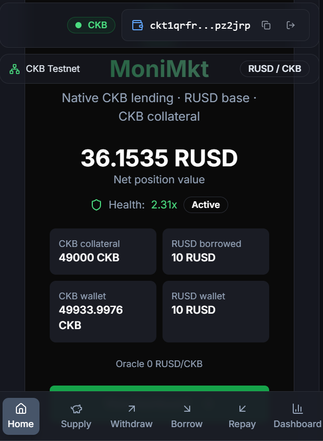
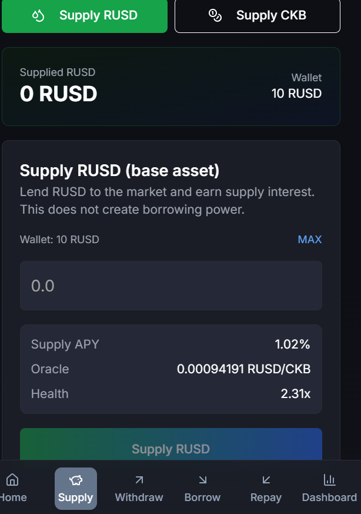
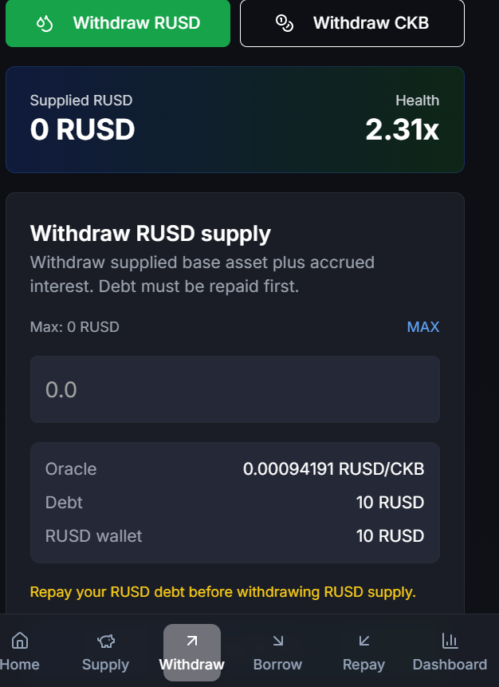
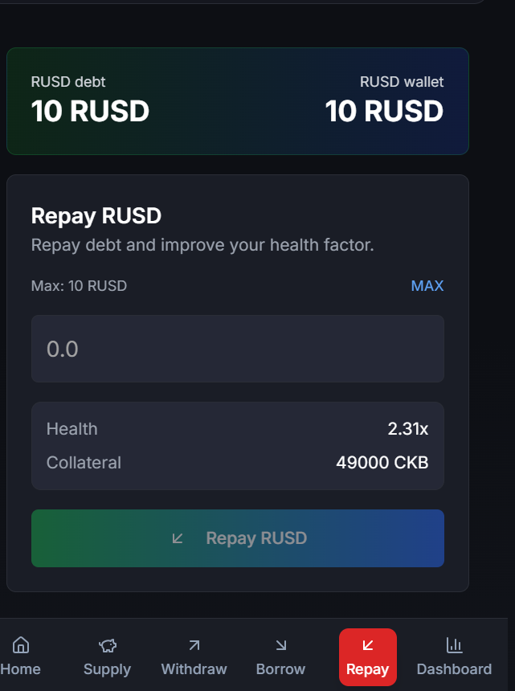
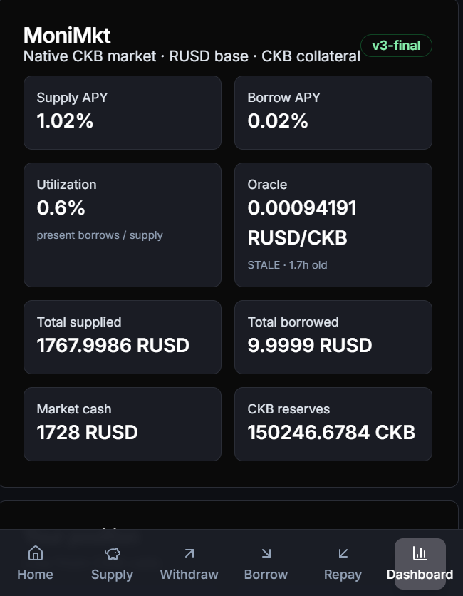

# Spark Program | MoniMkt: Hardening and Beta for a Native CKB Lending Market

## 1. Project Overview

**Project name:** MoniMkt

**One-line summary:** A native CKB lending market where RUSD is the base asset, CKB is collateral, and market state, positions, custody, and the oracle are all CKB cells.

**Positioning:** A working testnet market plus a static CKB wallet frontend, already live on Pudge testnet. This grant funds the final security hardening, oracle operations, and a real 20-30 user beta, not the initial build.

MoniMkt is an index-based lending market built for the CKB cell model. Lenders supply RUSD and earn interest. Borrowers deposit CKB and borrow RUSD. The market maintains signed principals, supply and borrow indices, utilization-based rates, collateral factors, and a liquidation path. Every action is a CKB transaction; lock and type scripts enforce custody and state transitions.

The project already has a deployed testnet market, a complete script set, a frontend that reads live cells and signs transactions, an automated multi-source oracle, and a 112-test local/CI gate. The remaining question is not whether it can work. It is whether it is defensible, observable, and usable by people who are not the author.

## 2. Team Profile

**Applicant / core developer:** North Bear, full-stack and Rust, protocol and smart-contract development.

- GitHub: https://github.com/NOrththebear/MoniMkt
- Email: capc55005@gmail.com
- Discord: northbears

I also built Bees Network, a CKB observation-layer MVP deployed on Pudge testnet, including its cell-based registry, epoch accounting, reward shares, and desktop client. MoniMkt applies the same approach to a different primitive: native credit accounting.

## 3. Project Background

CKB has strong primitives for custody, identity, and settlement, but it does not yet have a serious native lending market that treats cells as the accounting layer rather than wrapping an external execution environment.

The common shortcut is to put a lending UI in front of an off-chain ledger or a bridged contract. That loses the properties CKB is actually good at: explicit ownership, verifiable custody, script-enforced state transitions, and non-custodial settlement.

MoniMkt takes the harder but more useful path:

- `MarketState` is a singleton cell with indices, totals, cash, and pause flags.
- `AssetTotals` tracks supplied balances per asset.
- Base and collateral vaults are cells with their own custody rules.
- Each user has an `Account` and `Position` cell.
- `market-type` validates every transition, including interest accrual, supply, withdraw, borrow, repay, collateral changes, absorb, and discounted collateral purchase.
- The RUSD token cell is bound to the base vault by `base-token-lock`.
- The oracle is an on-chain cell with an explicit timestamp and publisher set.

This is a real CKB-native market, not a token wrapper or a database with a wallet popup.

### Category reference: Compound, rebuilt natively for CKB

Compound is the closest product reference. It proved that pooled on-chain lending, with supply and borrow indices, collateral factors, and liquidation, could become a core DeFi primitive on Ethereum. MoniMkt is the CKB equivalent: the same economic job, implemented with CKB cells and scripts rather than an account-based contract. This is not a port. The accounting model is adapted to cell ownership, explicit custody, and script-validated transitions.

## 4. Solution

MoniMkt gives CKB users a complete lending loop:

1. Connect a CKB wallet.
2. Initialize an Account and Position.
3. Supply RUSD to earn interest.
4. Supply CKB as collateral.
5. Borrow RUSD against CKB.
6. Repay RUSD.
7. Withdraw RUSD or CKB subject to market health.
8. Read live market and position state directly from CKB.

The frontend is a raw HTML/CSS/JavaScript app using CCC for wallet connection and transaction assembly. It is deliberately small, static-hostable, and wallet-native. There is no application framework runtime.

The market uses real CKB/USD pricing from a multi-source keeper. A stale or invalid oracle is treated as a market configuration failure, not silently accepted.

## 5. Technical Approach

**Contracts:** 13 RISC-V scripts deployed with Type ID:

- `market-type`
- `market-state-lock`
- `base-token-lock`
- `account-type`
- `position-type`
- `position-lock`
- `vault-type`
- `vault-lock`
- `oracle-type`
- `asset-config-type`
- `asset-totals-type`
- `approval-type`
- `config-type`

**State model:** fixed-size, Molecule-compatible encodings for `MarketState`, `AssetTotals`, `Account`, `Position`, `Approval`, `Vault`, `Oracle`, `Action`, and configuration cells.

**Asset model:** RUSD is a standard xUDT base asset. CKB is native collateral. The base-token custody lock checks that the net token-cell delta matches the base-vault delta. Token inputs deliberately keep an empty `WitnessArgs.inputType`; only the state, position, vault, and account inputs carry the market action witness.

**Frontend:** static HTML/CSS/JS in `web/`, CCC wallet connector, live cell discovery, transaction builders, transaction lifecycle states (preparing, confirm in wallet, confirming, confirmed/rejected), and a mobile-first dashboard.

**Oracle:** CKB/USD is the median of Binance, Gate.io, and CoinGecko, requiring at least two valid sources. A dedicated oracle updater key owns the oracle cell. A GitHub Actions workflow publishes every 15 minutes, within the market’s one-hour freshness window.

## 6. Security Hardening: Grant Scope

This is **security hardening, not an external audit**. I will state that plainly in the final report and will not describe the work as a third-party audit.

The hardening work covers:

- A written threat model for the market, vaults, token custody, positions, approvals, oracle, and frontend signing path.
- Adversarial review of every market transition and every lock/type script boundary.
- Expanded invariant and property tests:
  - indices remain monotonic for positive rates,
  - principal and present-value round trips never create value,
  - supply/withdraw and borrow/repay conserve value,
  - vault capacity covers occupied capacity plus amount,
  - base token delta equals base vault delta,
  - absorb and discounted collateral purchase cannot exceed reserves,
  - pause, nonce, and approval checks cannot be bypassed.
- Malformed-cell and boundary tests for decoders and amount handling.
- Fee, capacity, change, and sub-minimum cell edge cases.
- Frontend adversarial tests for wrong network, stale oracle, insufficient collateral, wallet rejection, malformed amounts, duplicate submission, and token/witness construction.
- CI gating so the hardening suite must pass on every push.

Findings will be fixed or documented with reproduction steps and residual risk.

## 7. Oracle Hardening: Grant Scope

The current oracle already uses three independent sources, a median, a 20% deviation guard, a dedicated updater key, and a 15-minute scheduled workflow.

This grant adds operational hardening:

- Source health and failover behavior when one venue is unavailable or returns an outlier.
- Stale-price alerting and a visible oracle age/status in the frontend.
- A keeper runbook covering key rotation, missed schedules, deviation trips, and manual fallback.
- Tests for stale price, future timestamp, zero price, wrong asset, wrong publisher set, and insufficient source count.
- A public freshness record for the beta period, including update cadence and missed updates.

The oracle remains a single-publisher testnet feed at the lock level. Multi-publisher signature verification is explicitly out of scope for this grant and will be named as a mainnet hardening item.

## 8. Beta Program: Grant Scope

The beta is a four-week structured test with **20-30 external testers**, not an open-ended demo.

**Wallet coverage:** every CKB wallet exposed by the CCC libraries used in the app, with a recorded matrix. JoyID is prioritized because it is the most widely used wallet among the testers I expect to recruit; OKX Wallet, UTXO Global, and Khie are also covered.

**Structured scripts:**

- Connect, disconnect, and reconnect.
- Initialize Account/Position.
- Supply RUSD.
- Supply CKB.
- Borrow RUSD.
- Repay RUSD.
- Withdraw RUSD.
- Withdraw CKB.
- Negative tests: insufficient collateral, stale oracle, wrong network, wallet rejection, invalid amount.

**Measured beta targets:**

| Metric | Target |
|---|---|
| External testers | 20-30 |
| Testers completing one full cycle | ≥15 |
| Wallet connection success | ≥90% per tested wallet |
| Transaction success excluding deliberate negative tests | ≥95% |
| Oracle age under 60 minutes | ≥99% of beta period |
| Critical custody or accounting failures | 0 |
| Median time to first supply | <10 minutes |
| Structured feedback responses | ≥15 |
| P0/P1 issues | fixed or documented with repro |

All test assets are valueless testnet CKB/RUSD. There are **no tester incentives** in this grant.

## 9. Execution Plan: 4 Weeks

Start: on acceptance. Target completion: mid-December 2026.

**Week 1: Security baseline**

Threat model, adversarial script review, invariant/property tests, decoder boundary tests, capacity/fee/change tests, frontend signing and failure-path tests. Fix critical findings and make the new suite part of CI.

Milestone: a hardening report with findings, fixes, and a green expanded test gate.

**Week 2: Oracle and beta build**

Oracle source health/failover, stale alerts, freshness display, keeper runbook, additional oracle tests. Frontend wallet matrix, onboarding, error states, and public beta build.

Milestone: a repeatable public beta build and an oracle status panel that shows price, age, and last update.

**Week 3: Beta launch and structured testing**

Recruit 20-30 testers. Run the structured scripts across the wallet matrix. Collect opt-in telemetry and structured feedback. Triage issues daily; fix P0/P1 issues and re-test.

Milestone: beta is live, test coverage is tracked, and the first beta metrics are published.

**Week 4: Fix, re-test, close**

Re-run the full test and beta scripts after fixes. Publish the beta report with actual metrics, wallet breakdown, issues, and verbatim feedback. Record a demo video, finalize docs, and publish the completion report and funding usage.

Milestone: `v1.0.0-beta`, public report, demo, and completion package.

## 10. Required Funding & Breakdown

**Requested: USD 2,000: payable in CKB only.**

**Why more than $1,000:** This is not a single-category request. It combines four coupled workstreams: contract security hardening, oracle operations, frontend/wallet hardening, and a real external beta. A $1,000 budget covers roughly one half of that; without the other half the beta is either unsafe or unvalidated. The work is deliberately scoped to four weeks and does not include mainnet deployment, a token, an external audit, or tester incentives.

| Item | Amount | Use |
|---|---:|---|
| Security hardening and invariant/fuzz suite (W1) | $650 | Threat model, script review, invariant/property tests, decoder/edge-case tests, fixes, CI |
| Oracle resilience and monitoring (W2) | $350 | Source health/failover, stale alerts, freshness UI, runbook, oracle tests |
| Frontend wallet and UX hardening (W2) | $400 | Wallet matrix, onboarding, error states, transaction lifecycle, beta build |
| Beta program and user testing (W3) | $450 | Recruit and support 20-30 testers, structured scripts, telemetry, feedback synthesis, fixes |
| Docs, demo video, completion report (W4) | $100 | Documentation, demo, beta/completion reports |
| Test infrastructure and contingency | $50 | CI runners, hosted testnet checks, test tokens |
| **Total** | **$2,000** | |

## 11. Deliverables + How to Verify

**Deliverables with acceptance criteria:**

1. **Open-source repository at `v1.0.0-beta`**: builds from a clean checkout; existing public repo continues.
2. **Security hardening report**: threat model, findings, fixes, residual risks, and explicit statement that no external audit was performed.
3. **Expanded test suite and CI**: invariant/property tests, decoder boundaries, custody/token checks, oracle failure tests, frontend failure paths; green CI run links.
4. **Oracle status and runbook**: live price, age, last update, source health; documented key rotation and manual fallback.
5. **Public beta build**: Vercel-hosted static frontend, wallet matrix, onboarding, and recovery/error guidance.
6. **Beta report**: 20-30 testers, wallet distribution, completed flows, success/failure rates, oracle freshness, issues found and fixed, retention, and verbatim feedback.
7. **Demo video and verification guide**: “verify in 5 minutes” instructions.
8. **Completion report**: plan versus actual, funding usage, lessons, and remaining mainnet work.

**How to verify without code review:**

- Open the public beta URL, connect a CKB wallet, initialize, supply RUSD, supply CKB, borrow, repay, and withdraw.
- Observe the transaction lifecycle states and the dashboard health/position values.
- Open the oracle panel and confirm the price and age are within the market’s freshness window.
- Open the GitHub Actions oracle runs and confirm scheduled updates.
- Open the provided Pudge explorer links and confirm market, supply, borrow, repay, withdraw, and oracle transactions.
- Open the CI run links or run the published test commands and see them pass.
- Read the beta report and check the measured metrics and unresolved issues.
- Watch the demo video.

**Expected output:** a hardened, observable testnet market; a stable public beta; 20-30 real testers; a measured beta report; and a clear list of remaining mainnet risks.

**Verification cost:** roughly 5-10 minutes per item; no committee code review required.

## 12. Current State vs Funded Work

**Already built and deployed: unfunded:**

- Live MoniMkt testnet market at `v3-final-r2`.
  - Market ID: `0x70e26d96e2b61a1c8e33104ccaf066e18e1e371737b0c4871738874627ba7481`
  - Create tx: `0x8ca00bb3086bdb6dc0a0ab7504697250b1d07aa98551837f3faa0bb2e7e67380`
- 13 RISC-V scripts deployed with Type ID.
- Working RUSD supply/withdraw, CKB collateral supply/withdraw, borrow/repay, absorb, and discounted collateral purchase on testnet.
- Static CKB frontend with CCC wallet connection, live cell reads, transaction builders, dashboard, history, and transaction lifecycle UX.
- Multi-source CKB/USD oracle keeper with median pricing, deviation guard, dedicated updater key, and 15-minute GitHub Actions schedule.
- 112 automated tests across math, schemas, market core, batching, indexer views, and `ckb-testtool` integration.
- On-chain evidence:
  - Oracle feed migration: `0xd5f4176d3a5d90c0381df455f823312329cef725c809947d593acd17f037eacc`
  - Oracle updater lock rotation: `0xc09a19de468edff4d4cece9347ef5a66967312afa022b7d26ada980a3b165fa3`
  - Oracle keeper workflow: https://github.com/NOrththebear/MoniMkt/actions/runs/42516011208
  - Frontend supply flow: `0x1c89e51fd2830676f8098e5c5fab228161f794a87bfa73eb9a9d0b9b5e058596`
  - Frontend borrow flow: `0x7cfee58767f02ed4e9bbb1738522a1b52f43c2f2998b45afb3fb0456b7d00329`

### Live product screenshots

The connected testnet app is available at https://monimkt-web.vercel.app/. These screens show the current product beyond the landing page: a connected wallet, live position, and the supply, withdraw, repay, and dashboard surfaces. The live app also includes the borrow flow.

*Home screen: connected CKB wallet, 36.1535 RUSD net position, 2.31x health, 49,000 CKB collateral, and 10 RUSD borrowed.*

*Supply screen: RUSD and CKB are separate actions; the form shows wallet balance, supply APY, oracle price, and health before signing.*

*Withdraw screen: separate RUSD and CKB paths, debt check, oracle, wallet balance, and an explicit block when debt must be repaid first.*

*Repay screen: live RUSD debt, wallet balance, health factor, collateral, and maximum repay amount.*

*Dashboard: market APY, utilization, oracle, total supplied, total borrowed, market cash, and CKB reserves. This capture also shows the stale-oracle warning. The keeper and monitoring work in this grant is specifically meant to make that warning rare and visible when it happens.*

**Funded by this grant: the delta:**

- Contract security hardening and expanded invariant/fuzz tests.
- Oracle monitoring, failure handling, freshness UI, and runbook.
- Wallet/beta hardening and a public beta build.
- 20-30 external testers, structured scripts, metrics, and feedback loop.
- Beta report, demo, docs, and completion report.

**Not claimed:** this grant does not fund the initial market, a mainnet launch, a token, a reward pool, tester incentives, or an external audit.

## 13. Risks, Limits, Non-Goals

- **No external audit.** This is a hardening sprint. Residual risk will be documented, and mainnet would require an independent audit.
- **Real oracle price.** The live CKB price is far below the earlier manual test price. Beta testers may need more testnet CKB to reach useful borrow limits; the project will provide valueless testnet tokens and clear guidance.
- **Single oracle publisher at the lock level.** Multi-source pricing improves correctness, but the updater key remains a trust point. Dedicated key, deviation guard, monitoring, and rotation are in scope; multi-publisher verification is not.
- **Wallet library variance.** CCC-supported wallets can behave differently; the beta includes a wallet matrix and per-wallet reporting.
- **Small beta sample.** 20-30 testers produce directional evidence, not statistical proof. The report will state this.
- **Scheduled keeper dependency.** GitHub Actions can be delayed; the keeper supports manual runs and has a documented fallback.

**Non-goals:** mainnet deployment, token issuance, liquidity incentives, reward pools, a new market design, or a general-purpose indexer.

## 14. CKB Alignment

MoniMkt is native to the CKB cell model:

- `MarketState`, `AssetTotals`, vaults, accounts, positions, approvals, and the oracle are cells.
- Type scripts enforce accounting and state transitions; lock scripts enforce ownership and custody.
- RUSD is an xUDT; CKB collateral is native; base-token custody is bound to the base vault.
- Type ID is used for script deployment and upgrade discipline.
- Users sign their own transactions; the shared state lock is permissive and `market-type` is the guard.
- The frontend reads live cells directly and does not rely on an off-chain ledger as the source of truth.

CKB is not a settlement afterthought here. The market’s state machine and custody model are the product.

## 15. Closing

I built MoniMkt because CKB should have a lending market that uses its actual cell model, not a borrowed application architecture. The market already works on testnet. What it lacks is the last mile: adversarial hardening, an oracle that stays fresh without manual intervention, and real users putting the flows under pressure.

This grant is for that last mile. Four weeks, $2,000 in CKB, no mainnet, no token, no incentives: a defensible testnet beta and an honest report on what remains.
